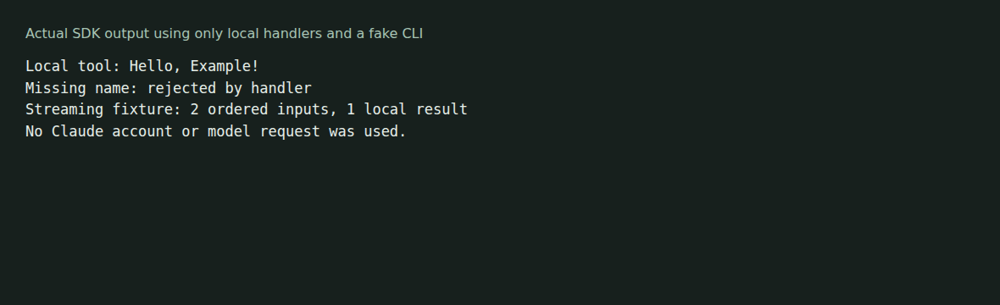

# Claude Agent SDK for F#

An F# library for working with the Claude CLI protocol, messages, hooks and local MCP tools. It uses records, discriminated unions and asynchronous sequences. It is not an official Anthropic SDK, and full parity with a particular upstream version has not been established.



The [offline example](examples/OfflineDemo/Program.fs) calls a local tool handler and exchanges synthetic messages with a bundled fake CLI. No account, model request or real Claude process is used. See [capture notes](docs/demo/README.md).

## Build and run locally

Install the .NET 8 SDK:

```sh
git clone https://github.com/Microapps-Labs/claude-agent-sdk-fsharp.git
cd claude-agent-sdk-fsharp
dotnet test tests/ClaudeAgentSdk.Tests/ClaudeAgentSdk.Tests.fsproj -c Release
dotnet run --project examples/OfflineDemo -c Release
```

On Linux, also exercise the streaming-input subprocess fixture:

```sh
dotnet run --project examples/OfflineDemo -c Release -- examples/OfflineDemo/fake-cli.sh
```

The captured run used .NET SDK 8.0.426 on Linux ARM64. All 102 tests passed, including two regressions for reading buffered stdout after a child process exits. A small input-loop refactor fixes the SDK's warning-as-error build failure without disabling that compiler check. Test fixtures still produce resumable-code warnings.

## Use with Claude

Live queries require a separately installed Claude CLI, its authentication and an account able to make requests. The live examples can invoke tools and incur model usage. They were not executed for this capture. See the [API and example reference](docs/reference.md) and [examples/BasicUsage](examples/BasicUsage/) before running them.

The source package targets net8.0. No NuGet publication or current upstream-version compatibility is claimed here. Use a project reference to this checkout when integrating from source.

[Implementation guidance](CLAUDE.md). The package metadata declares MIT; this checkout has no standalone license file.
